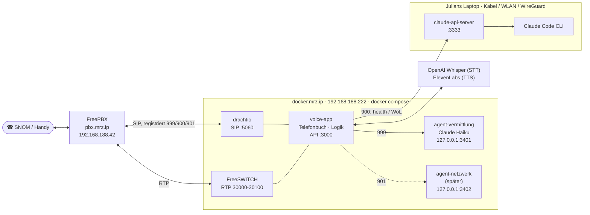
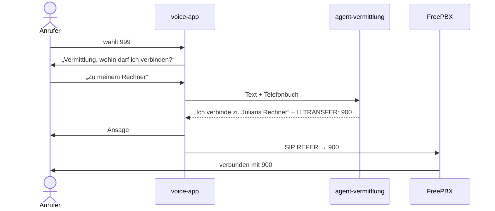
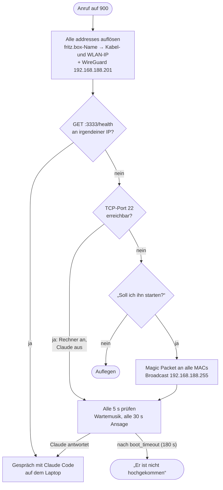
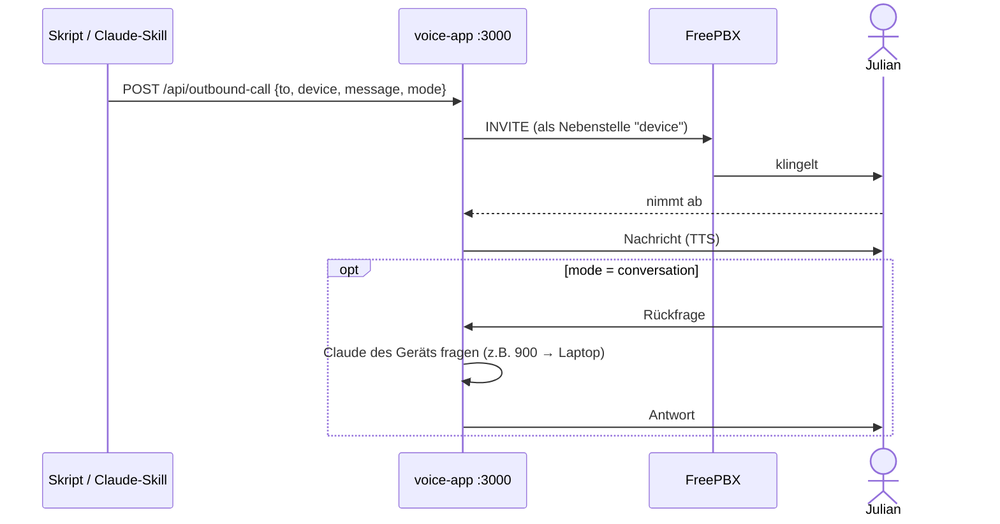

<p align="center">
  
</p>

# Claude Phone für FreePBX

Mit Claude telefonieren, über die FreePBX zu Hause. Fork von
[theNetworkChuck/claude-phone](https://github.com/theNetworkChuck/claude-phone)
(dessen Original-README liegt unter [docs/UPSTREAM-README.md](docs/UPSTREAM-README.md)).

Unterschiede zum Original:

- **Kein Install-Skript.** Alles steht in `docker-compose.yml`, `.env` und `agents/`.
- **Telefonbuch in der Compose-Datei.** Pro Nebenstelle steht dort, was sie tut und wo der Anruf landet.
- **Mehrere Hosts.** Rechner werden geprüft und per Wake-on-LAN geweckt. Laptops mit wechselnden IPs werden unterstützt.
- **Claude-Agents als Container.** Jeder Agent hat einen eigenen Ordner mit Persönlichkeit und Rechten.
- **Vermittlung.** Claude nimmt den Anruf an und stellt ihn per SIP-REFER durch.

---

## Nebenstellen

| Nr. | Name | Typ | Was passiert |
|-----|------|-----|--------------|
| **999** | Vermittlung | `operator` | Claude (Haiku, Container `agent-vermittlung`) fragt, wohin der Anruf soll, und stellt durch |
| **900** | Julians Rechner | `host` | Prüft den Laptop. Läuft er, landest du bei Claude Code auf dem Laptop. Ist er aus, bietet 900 Wake-on-LAN an |
| **901** | Netzwerk-Agent | `placeholder` | Sagt im Moment nur „noch nicht eingerichtet“ |

## Architektur



Was läuft wo:

| Host | Was läuft | Wie gestartet |
|------|-----------|---------------|
| **docker.mrz.ip** | drachtio, FreeSWITCH, voice-app, agent-vermittlung | `docker compose up -d` in `~/docker/claude-phone-freepbx` |
| **Laptop** | nur `claude-api-server` auf Port 3333 | `node claude-api-server/server.js` (siehe [Laptop vorbereiten](#5-laptop-vorbereiten-für-900)) |
| **pbx.mrz.ip** | FreePBX, Nebenstellen 999/900/901 als PJSIP | Skill `freepbx-extension` |

### Ablauf 999 – Vermittlung



### Ablauf 900 – Host prüfen und wecken



### Rückruf – Claude ruft dich an



```bash
curl -X POST http://192.168.188.222:3000/api/outbound-call \
  -H 'Content-Type: application/json' \
  -d '{"to": "10", "device": "900", "message": "Backup ist fertig.", "mode": "announce"}'
```

---

## Einrichtung Schritt für Schritt

Verzeichnisse:

| Wo | Pfad | Wozu |
|----|------|------|
| Laptop | `~/BashScripts/claudeProjects/ClaudePhoneFreePbx` | hier entwickeln, committen, pushen |
| docker.mrz.ip | `~/docker/claude-phone-freepbx` | hier läuft der Stack, nur `git pull` |

> `~/docker` auf docker.mrz.ip ist der Clone von `home-docker-stacks`.
> `claude-phone-freepbx` liegt darin als **eigener Git-Clone** (dajuly20/claude-phone-freepbx)
> und gehört nicht zum home-docker-stacks-Repo. Portainer brauchst du dafür nicht.

### 1. Nebenstellen in FreePBX ✅

Erledigt: 999, 900 und 901 sind angelegt, ihre Secrets stehen in der `.env`.
Neue Nebenstellen legt der Skill an:

```bash
~/.claude/skills/freepbx-extension/freepbx-ext.sh 902 'Proxmox'
# PBX sperrt die eigene IP? Dann über den Docker-Host:
~/.claude/skills/freepbx-extension/freepbx-ext.sh --jump julian@docker.mrz.ip 902 'Proxmox'
```

### 2. Claude-Token erzeugen (Laptop)

Den Token brauchen die Agent-Container (999, später 901). Er läuft über dein Claude-Abo.

```bash
claude setup-token
```

Es öffnet sich ein Browser-Login. Danach gibt der Befehl einen langen Token aus,
der mit `sk-ant-oat…` beginnt. Kopieren.

### 3. Token in die `.env` auf docker.mrz.ip

```bash
ssh docker.mrz.ip
cd ~/docker/claude-phone-freepbx
nano .env          # Zeile  CLAUDE_CODE_OAUTH_TOKEN=  → Token dahinter einfügen
```

Kontrolle, ohne den Token anzuzeigen:

```bash
grep -c '^CLAUDE_CODE_OAUTH_TOKEN=sk-ant-' .env     # muss 1 ausgeben
docker compose config -q && echo "Compose ok"
```

### 4. Stack starten (docker.mrz.ip)

```bash
cd ~/docker/claude-phone-freepbx
git pull                          # neuesten Stand holen
docker compose up -d --build      # beim ersten Mal dauert der Build ein paar Minuten
docker compose ps                 # alle 4 Services "running"?
docker compose logs -f voice-app  # Strg+C beendet nur das Mitlesen
```

Im Log der voice-app sollte bei jeder Nebenstelle eine erfolgreiche Registrierung stehen,
`[REGISTRAR] SUCCESS - Registered as extension 999` (dasselbe für 900 und 901). In FreePBX unter *Reports → Asterisk Info → Peers*
oder auf der PBX mit `sudo asterisk -rx 'pjsip show contacts'` müssen die drei
mit `192.168.188.222` auftauchen.

Testen:

| Test | Erwartung |
|------|-----------|
| 901 anrufen | „Der Netzwerk-Agent ist noch nicht eingerichtet“ |
| 999 anrufen, „verbinde mich mit 901“ | Ansage, danach landest du auf 901 |
| 900 anrufen (Laptop-API aus) | „Soll ich ihn starten?“ |
| `curl http://192.168.188.222:3000/api/devices` | Liste der Nebenstellen |

Agent einzeln prüfen:

```bash
curl -s http://127.0.0.1:3401/health
docker compose logs agent-vermittlung
```

### 5. Laptop vorbereiten (für 900)

Auf dem Laptop läuft nur der `claude-api-server`. Für einen ersten Test reicht:

```bash
cd ~/BashScripts/claudeProjects/ClaudePhoneFreePbx/claude-api-server
npm install
CLAUDE_WORKDIR=$HOME node server.js
```

Damit er dauerhaft läuft, eine systemd-User-Unit
`~/.config/systemd/user/claude-api-server.service`:

```ini
[Unit]
Description=Claude API Server (Claude Phone, Nebenstelle 900)
After=network-online.target

[Service]
WorkingDirectory=%h/BashScripts/claudeProjects/ClaudePhoneFreePbx/claude-api-server
Environment=CLAUDE_WORKDIR=%h
ExecStart=/usr/bin/env node server.js
Restart=on-failure

[Install]
WantedBy=default.target
```

```bash
systemctl --user daemon-reload
systemctl --user enable --now claude-api-server
loginctl enable-linger $USER     # läuft auch ohne angemeldete Sitzung
```

> ⚠ Wer Port 3333 erreicht, kann Claude Code mit `--dangerously-skip-permissions`
> auf dem Laptop steuern. Freigeben also nur fürs Heimnetz und für WireGuard.

**Wake-on-LAN** geht nur per Kabel (Dock oder Onboard), wenn der Laptop am Netzteil hängt
und WoL im BIOS aktiviert ist. Unter Linux zusätzlich:

```bash
sudo ethtool -s <interface> wol g
```

### 6. Rückruf-Skill (Laptop)

`~/.claude/skills/call/lib/api.py` zeigt schon auf `http://192.168.188.222:3000`.
Was noch fehlt: deine eigene Nummer als Kontakt „me“, damit „ruf mich an“ funktioniert.

---

## Konfiguration ändern

| Was | Wo | Danach |
|-----|----|--------|
| Nebenstelle hinzufügen/ändern | `docker-compose.yml` → `configs.telefonbuch.extensions` | `docker compose up -d` |
| Host hinzufügen | `docker-compose.yml` → `hosts` | `docker compose up -d` |
| Persönlichkeit/Rechte eines Agents | `agents/<name>/CLAUDE.md`, `.claude/settings.json` | `docker compose restart agent-<name>` |
| Neuer Agent | Ordner `agents/<name>/` + Service `agent-<name>` | `docker compose up -d --build` |
| Secrets | `.env` | `docker compose up -d` |

Details zu allen Feldern stehen in [docs/NEBENSTELLEN.md](docs/NEBENSTELLEN.md).
Zu den Agents siehe [agents/README.md](agents/README.md).

Workflow: am Laptop ändern → `git push` → auf docker.mrz.ip `git pull && docker compose up -d --build`.

---

## Ideen für später

**Agents und Nebenstellen**
- **901 Netzwerk-Agent:** darf `nmap`, `ping`, `fping` und `scripts/network_audit.py`. Anfragen wie „Welche Geräte sind neu im Netz?“ oder „Ist der Proxmox erreichbar?“
- **902 Proxmox:** VM-Status und Backups abfragen, eine VM starten. Lesender API-Token, Schreibrechte nur für ausgewählte Befehle.
- **903 Home Assistant:** „Mach das Licht im Büro aus“ oder „Wie warm ist es draußen?“ über die HA-REST-API (der Token ist schon für den Alexa-Sync da).
- **904 TODO-Diktat:** Was du sagst, landet in `TODO.md` oder Todoist. Gegenstück zum Alexa-Sync.
- **Vermittlung mit Gedächtnis:** „wie letztes Mal“ verbindet mit der zuletzt gewählten Nebenstelle. Dazu Anrufer-Erkennung über die Caller-ID.

**Rückrufe und Alarme**
- **Monitoring ruft an:** Uptime Kuma, Proxmox-Backup-Fehler oder ein volles Storage-Box-Mount lösen `POST /api/outbound-call` aus. Mit `mode: conversation` kannst du direkt fragen „Was genau ist kaputt?“
- **Eskalation:** erst Push-Nachricht, nach 10 Minuten ohne Reaktion Anruf.
- **Ruhezeiten:** nachts nur Alarme mit Priorität „kritisch“.

**Telefonbuch und Telefone**
- **Google-Kontakte → SNOM:** ein kleiner Dienst (People API oder CardDAV), der ein Snom-XML-Telefonbuch bereitstellt oder den FreePBX Contact Manager befüllt. Dieselben Kontakte kennt dann auch die Vermittlung („verbinde mich mit Mama“).
- **Externe Ziele für 999:** Handynummern unter `directory:` eintragen und über den Trunk vermitteln.

**Sicherheit und Betrieb**
- **API-Schlüssel für Port 3000:** Im Moment kann jeder im LAN Anrufe auslösen.
- **PIN für 900:** vor dem Zugriff auf Claude Code mit vollen Rechten eine Ziffernfolge abfragen (DTMF).
- **Laptop-API nur für docker.mrz.ip:** Firewall-Regel auf dem Laptop, die Port 3333 nur für 192.168.188.222 freigibt.
- **Healthcheck und Restart:** `healthcheck:` für voice-app und Agents in der Compose-Datei, Status in Uptime Kuma.
- **Kosten im Blick:** Whisper- und ElevenLabs-Minuten pro Anruf loggen.

**Sprache**
- **Lokale STT/TTS:** whisper.cpp oder faster-whisper und Piper auf docker.mrz.ip, dann ohne Cloud-Kosten.
- **Unterbrechen (Barge-in):** dazwischenreden, während Claude spricht.

---

## Entwicklung

```bash
npm install
npm test          # alle Tests
npm run lint
```

Technische Details zum Code: [CLAUDE.md](CLAUDE.md) · Fehlersuche: [docs/TROUBLESHOOTING.md](docs/TROUBLESHOOTING.md)
